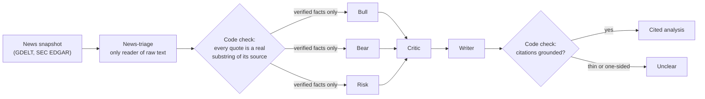

# Multi-Agent Research Desk

A multi-agent system that turns a stock ticker and a snapshot of recent news into a **cited, abstention-aware research note**. Specialist agents argue the bull case, the bear case and the risks, a critic checks every claim against its sources, and the system says "unclear" when the evidence is thin.

> **Status: design phase.** There is no code yet. This repository currently holds the design: a decision map, the research behind it, and the rules the build will follow. Everything below describes the planned system, not a finished one.
>
> **Not financial advice.** The desk never predicts prices and never recommends trades. It summarizes what published sources say, with citations.

## Why this project exists

I wanted a portfolio project that shows more than "I can call an LLM". It is built around the parts of agent systems that are usually skipped: untrusted input, grounding, evaluation without ground truth, tracing and cost control. The domain comes from my own portfolio tracker, which already has a single-call news analysis. The research desk replaces that one call with a team of agents and measures whether that is actually better.

## Planned architecture

- **Quarantine boundary.** Only the triage agent reads raw article text. Everything downstream sees quote-verified facts, so a poisoned article cannot talk to the agents that form the judgment.
- **Grounding in code, not in prompts.** Citations and quotes are checked by ordinary code. Unsupported claims are dropped and the system abstains rather than guess.
- **No tools, no secrets** for any agent that touches untrusted text. No personal data enters a prompt.

## What will be built

| Piece | Plan |
|---|---|
| Orchestration | LangGraph supervisor with parallel Bull and Bear agents |
| Framework comparison | One agent rebuilt in CrewAI, compared on quality, cost, latency and code size |
| Models | Anthropic by default via `langchain-anthropic`, switchable by environment variable, a cheaper model for CI |
| Evals | Frozen synthetic news snapshots, citation validity, unsupported-claim rate, abstention on thin news, and about 20 paired clean/poisoned prompt-injection cases |
| Tracing | Langfuse, with LangGraph and CrewAI runs traced to the same backend |
| Delivery | Standalone Python engine package (`stock_news_desk`, built with `uv`) in this repo; a FastAPI service and a small UI later, each in its own repo |
| Safety | Pre-push secret and path scanning, both as a local hook and in CI |

## Design decisions so far

- **Domain:** stock-news research, with agents for triage, bull, bear, risk, critic and writing.
- **Injection defence:** quarantine through the triage agent, with paired clean/poisoned evals. See the [threat model](docs/wayfinder/research-desk/08-prompt-injection-threat-model.md).
- **Privacy:** ticker-only analysis in v1, no personalization, no personal data in prompts, traces or evals. See [demo privacy](docs/wayfinder/research-desk/13-demo-privacy-and-synthetic-portfolio.md).
- **Data:** no data from sources whose terms forbid redistribution is committed or shown. The live demo uses GDELT (cited) and SEC EDGAR, CI runs on fixtures with mocks, and the eval set is mostly synthetic articles plus a few EDGAR excerpts. GDELT supplies headlines only, so thin snapshots are expected. Research: [12-research.md](docs/wayfinder/research-desk/12-research.md).
- **Out of scope:** price forecasts, trade execution, accounts, real personal data.

## Known limitations

- **Headlines, not articles.** The desk reads GDELT headlines and SEC EDGAR filing text. It does not fetch publisher article pages, so analyses built from headlines are shallow and many tickers will come back `unclear`. That is the desk working as designed.
- **Synthetic evals.** The eval set is mostly written by a model and reviewed by a person, so scores will look better than real-world performance. A few real filing excerpts keep it grounded.
- **No price or fundamentals data,** and no personalization in v1.

## How the design is being done

The work follows a "wayfinder" process: the project is charted as a map of small decision tickets, each resolved in its own session, and nothing is built until the design is approved. The map and tickets live in [`docs/wayfinder/research-desk/`](docs/wayfinder/research-desk/map.md).

| Ticket | State |
|---|---|
| Repo and package layout | Closed |
| Analysis schema and engine interface | Closed |
| Supervisor design | Closed |
| Output and abstention policy | Closed |
| Cost and latency budget | Closed |
| Relationship to Freeman | Closed |
| Prompt-injection threat model | Closed |
| Demo privacy | Closed |
| Data sources and terms | Closed |
| Tracing stack | Closed |
| Eval metrics, snapshots and CI gating | Closed |
| Full-article fetching | Closed (not in v1) |
| LangGraph vs CrewAI protocol | Open |

## Roadmap

1. Finish the design tickets and write the spec.
2. Engine package: schema, triage with quote verification, agents, supervisor, grounding.
3. Evals and tracing, with results published in this README.
4. LangGraph vs CrewAI comparison write-up.
5. FastAPI service, then a small UI.

## License

MIT for the code, see [LICENSE](LICENSE). Committed eval data keeps the terms of its source.
